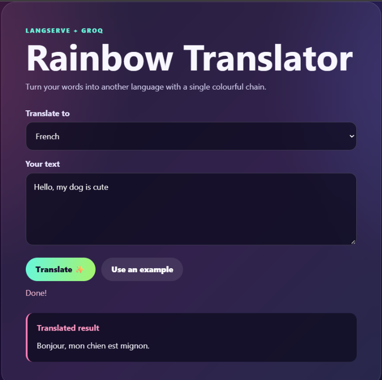

# 🦜🔗 LangChain Learning Lab — Complete Journey

> Hands-on notebooks for learning LangChain, chat models, prompt engineering,
> LCEL, RAG, memory, agents, observability, and deployment.

This repository is a complete, practical journey through the LangChain
ecosystem. It progresses from the first model call to production-oriented
patterns: composable chains, document retrieval, conversational memory,
tool-using agents, tracing, and a browser-based LangServe application.

> ✅ **Repository complete:** the learning path and final demonstrations are
> documented below. Use the notebooks as independent, runnable study modules.

## 🧰 Technology toolbox

| Tool | Purpose |
|---|---|
| 🐍 **Python** | Runtime for every notebook and API example |
| 🦜🔗 **LangChain** | Models, prompts, tools, parsers, loaders, and chains |
| 🧩 **LCEL** | Compose runnables with the `|` operator |
| 🕸️ **LangGraph** | ReAct agents, graph execution, streaming, and checkpoints |
| 🚀 **LangServe** | Expose LangChain runnables as HTTP endpoints |
| ⚡ **FastAPI** | Web API and interactive Swagger documentation |
| 🌐 **Uvicorn** | Local ASGI server for the translator application |
| 🤖 **Groq** | Chat model provider used throughout the agent and chat examples |
| 🧠 **OpenAI** | Chat models and embeddings for selected RAG examples |
| 🔎 **Tavily** | Live web search tool used by the LangGraph agent |
| 🧱 **Chroma** | Vector retrieval examples |
| 📚 **FAISS** | In-memory similarity search examples |
| 🧪 **LangSmith** | Tracing and observability for LangChain runs |
| 🔐 **python-dotenv** | Load API keys from local `.env` files |
| 📓 **Jupyter** | Interactive notebook-based learning |

## 🌟 Learning path

| Module | Focus | Main provider | Start here |
|---|---|---|---|
| [`Langchain_1`](./Langchain_1/) | LLM calls, streaming, temperature, chat messages, and provider integrations | OpenAI + Groq | [`01_talk_with_llm.ipynb`](./Langchain_1/01_talk_with_llm.ipynb) |
| [`Langchain_2`](./Langchain_2/) | Prompt templates, few-shot prompting, chains, LCEL, and output parsers | Groq | [`02_talk_with_llm_part2.ipynb`](./Langchain_2/02_talk_with_llm_part2.ipynb) |
| [`Langchain_3`](./Langchain_3/) | Document loaders, text splitting, embeddings, vector stores, retrievers, and RAG | Groq + OpenAI | [`DataLoader_RAG_Implementation.ipynb`](./Langchain_3/DataLoader_RAG_Implementation.ipynb) |
| [`Langchain_4`](./Langchain_4/) | LCEL composition, built-in runnables, and retrieval chains | Groq + OpenAI | [`LCEL.ipynb`](./Langchain_4/LCEL.ipynb) |
| [`LangChain_5`](./LangChain_5/) | Advanced LCEL composition, web RAG, and conversational memory | Groq + OpenAI | [`LCEL_little_more.ipynb`](./LangChain_5/LCEL_little_more.ipynb) |
| [`Langchain_6`](./Langchain_6/) | LangGraph agents, LangSmith tracing, and LangServe deployment | Groq + Tavily | [`langgraph_Impletation.ipynb`](./Langchain_6/langgraph_Impletation.ipynb) |

## 🧠 Concepts covered

- **Model invocation** with `.invoke(...)`
- **Streaming** responses with `.stream(...)`
- **Temperature** and response creativity
- **Chat messages** using system, human, and AI roles
- **Prompt templates** with reusable variables
- **Few-shot prompting** with examples
- **Chains** that connect prompts, models, and parsers
- **LangChain Expression Language (LCEL)** using runnable pipelines
- **Built-in runnables** including `RunnablePassthrough`, `RunnableLambda`, and
  `RunnableParallel`
- **Dictionary-based chain inputs** with `itemgetter`
- **Composable retrieval chains** that pass context, questions, and extra
  instructions through one pipeline
- **Runnable configuration** with `.bind(...)`
- **Nested and composed LCEL chains**
- **JSON output parsing**
- **Pydantic-based structured output**
- **Document loading** from TXT, CSV, HTML, PDF, and Wikipedia
- **Text splitting** with character-based and recursive splitters
- **Embeddings** with OpenAI
- **Vector stores** with Chroma and FAISS
- **Similarity retrieval** with configurable result counts
- **Retrieval-Augmented Generation (RAG)** with LCEL
- **Web-based RAG** with `WebBaseLoader`, Chroma, and hub prompts
- **Conversation memory** with buffer memory, window memory, and message
  history
- **ReAct agents** with LangGraph and external tools
- **Tavily web search** for current-information agent workflows
- **Checkpointed agent memory** with `MemorySaver` and thread IDs
- **LangSmith tracing** with `LANGCHAIN_TRACING_V2`
- **LangServe APIs** and FastAPI interactive documentation
- **Browser frontend** for a colourful translation chain
- Secure environment-variable loading with `python-dotenv`

## 📁 Repository structure

```text
LangChain/
├── Langchain_1/
│   ├── 01_talk_with_llm.ipynb
│   ├── GENAI_Langchain_1.pdf
│   ├── requirements.txt
├── Langchain_2/
│   ├── 02_talk_with_llm_part2.ipynb
│   ├── requirements.txt
│   └── .gitkeep
├── Langchain_3/
│   ├── DataLoader_RAG_Implementation.ipynb
│   ├── RAG_component.ipynb
│   ├── RAG_Implementation.ipynb
│   └── data/
├── Langchain_4/
│   ├── LCEL.ipynb
│   ├── LCEL_builtin_runnables.ipynb
│   └── LCEL_GenAI.pdf
├── LangChain_5/
│   ├── LCEL_little_more.ipynb
│   └── Memory_langchain.ipynb
├── Langchain_6/
│   ├── langgraph_Impletation.ipynb
│   ├── langsmith_Implementation.ipynb
│   ├── langserve_Implementation.py
│   └── test.py
├── assets/
│   └── rainbow-translator.png
├── requirements.txt
├── .env.example
├── .gitignore
└── README.md
```

## 🚀 Quick start

### 1. Clone the repository

```bash
git clone https://github.com/Jami40/LangChain_Orchastation.git
cd LangChain_Orchastation
```

### 2. Create an environment

```bash
conda create -n llmapp python=3.11 -y
conda activate llmapp
```

Or use a Python virtual environment:

```powershell
python -m venv .venv
.\.venv\Scripts\Activate.ps1
```

Confirm that the selected interpreter is Python 3.11 before installing:

```powershell
python --version
```

### 3. Install dependencies

Install the shared requirements:

```powershell
python -m pip install -r .\requirements.txt
```

The notebooks in `Langchain_3` also use the packages listed in
[`Langchain_1/requirements.txt`](./Langchain_1/requirements.txt), including
the Chroma and PDF integrations. Install that file as well when running the
vector-store and PDF examples:

```powershell
python -m pip install -r .\Langchain_1\requirements.txt
```

If `python --version` shows Python 3.13 or another version, select the
`llmapp` interpreter in VS Code first. This pinned LangChain learning stack is
tested with Python 3.11.

When a future module introduces a new import, add its package to this root
file and reinstall it in the same environment.

The LangGraph search example also requires Tavily's client package:

```powershell
python -m pip install tavily-python
```

### 4. Configure provider keys

Create a root `.env` file from the template:

```powershell
copy .env.example .env
```

Add your key:

```env
GROQ_API_KEY=your_groq_api_key
OPENAI_API_KEY=your_openai_api_key
TAVILY_API_KEY=your_tavily_api_key
LANGCHAIN_API_KEY=your_langsmith_api_key
LANGCHAIN_TRACING_V2=true
```

`GROQ_API_KEY` is used by the chat and document-loader examples. The RAG
implementation uses `OPENAI_API_KEY` for OpenAI embeddings and `ChatOpenAI`.
The LangGraph agent uses `TAVILY_API_KEY`. LangSmith tracing uses
`LANGCHAIN_API_KEY` and `LANGCHAIN_TRACING_V2=true`. All keys are loaded
locally and are never committed. Create keys from the
[Groq Console](https://console.groq.com/) and
[OpenAI platform](https://platform.openai.com/api-keys),
[Tavily](https://tavily.com/), and
[LangSmith](https://smith.langchain.com/).

### 5. Open a notebook

Open the module notebook in VS Code or Jupyter:

- [`01_talk_with_llm.ipynb`](./Langchain_1/01_talk_with_llm.ipynb)
- [`02_talk_with_llm_part2.ipynb`](./Langchain_2/02_talk_with_llm_part2.ipynb)
- [`DataLoader_RAG_Implementation.ipynb`](./Langchain_3/DataLoader_RAG_Implementation.ipynb)
- [`RAG_component.ipynb`](./Langchain_3/RAG_component.ipynb)
- [`RAG_Implementation.ipynb`](./Langchain_3/RAG_Implementation.ipynb)
- [`LCEL.ipynb`](./Langchain_4/LCEL.ipynb)
- [`LCEL_builtin_runnables.ipynb`](./Langchain_4/LCEL_builtin_runnables.ipynb)
- [`LCEL_little_more.ipynb`](./LangChain_5/LCEL_little_more.ipynb)
- [`Memory_langchain.ipynb`](./LangChain_5/Memory_langchain.ipynb)
- [`langgraph_Impletation.ipynb`](./Langchain_6/langgraph_Impletation.ipynb)
- [`langsmith_Implementation.ipynb`](./Langchain_6/langsmith_Implementation.ipynb)

In VS Code, choose the same Python environment where the dependencies were
installed, restart the notebook kernel, and run cells from top to bottom.

The Langchain_3 notebooks expect the working directory to be `Langchain_3`
when relative paths such as `./data/...` are used. Select that folder as the
notebook root, or adjust the paths for your environment.

## 🔧 Current models

`Langchain_2` and the loader examples use Groq:

```python
ChatGroq(
    model="openai/gpt-oss-120b",
    groq_api_key=groq_api_key,
)
```

Provider model availability can change. If Groq returns a `model_not_found`
error, check the [current Groq model list](https://console.groq.com/docs/models)
and update the notebook model name.

`Langchain_3/RAG_Implementation.ipynb` uses OpenAI for both embeddings and the
chat model:

```python
OpenAIEmbeddings()
ChatOpenAI()
```

The notebook builds a FAISS index from a text document, retrieves relevant
chunks, and combines the retriever, prompt, model, and string parser into an
LCEL chain.

## 🔗 LCEL runnable examples

`Langchain_4` builds on the earlier RAG work with small, composable runnable
examples:

- `RunnablePassthrough` forwards the original input unchanged.
- `RunnableLambda` wraps a custom Python function for use in a chain.
- `RunnableParallel` computes multiple named values from the same input.
- `itemgetter` selects fields from dictionary inputs before passing them to a
  retriever or prompt.

The advanced example combines a FAISS retriever, `RunnableParallel`,
`ChatPromptTemplate`, `ChatOpenAI`, and `StrOutputParser`. It accepts a
question and a requested language, retrieves context for the question, and
returns the answer in that language. `LCEL.ipynb` also contrasts the modern
`prompt | model | parser` style with the deprecated `LLMChain` API.

## 🧩 Advanced LCEL and memory examples

`LangChain_5/LCEL_little_more.ipynb` extends the runnable patterns with:

- `.bind(...)` for adding model arguments to a runnable
- Chains composed from the outputs of other chains
- `itemgetter` for mapping selected input fields into nested chains
- A web RAG pipeline using `WebBaseLoader`, recursive splitting, Chroma,
  OpenAI embeddings, and a prompt pulled from LangChain Hub

`LangChain_5/Memory_langchain.ipynb` demonstrates conversational state with
Groq and chat prompts that include a `MessagesPlaceholder` for history. It
covers:

- `ConversationBufferMemory` with `LLMChain` for retaining the full
  conversation
- `ConversationBufferWindowMemory` with a two-exchange history limit
- `ChatMessageHistory` for manually storing user and assistant messages

The notebook uses the `chat_history` memory key to connect stored messages to
the prompt template.

## 🌈 LangServe translator frontend

`Langchain_6/langserve_Implementation.py` exposes the translation chain
through FastAPI and LangServe, with a colourful browser interface for entering
text, selecting a target language, and viewing the translated result.

Start the server from the project root:

```bash
python Langchain_6/langserve_Implementation.py
```

Then open the frontend at [http://localhost:8000/](http://localhost:8000/).
The API documentation is available at
[http://localhost:8000/docs/](http://localhost:8000/docs/), and the LangServe
playground is available at
[http://localhost:8000/chain/playground/](http://localhost:8000/chain/playground/).



## 🕸️ LangGraph agent

`Langchain_6/langgraph_Impletation.ipynb` builds a ReAct agent with:

- `ChatGroq` as the reasoning model
- `TavilySearchResults` as a live web-search tool
- `create_react_agent` for tool-calling execution
- `.invoke(...)` for complete responses
- `.stream(...)` for incremental agent updates
- `MemorySaver` for checkpointed conversations
- `thread_id` values for isolated conversation threads

The agent can search for current information, call the tool when needed, and
remember earlier messages within the same configured thread.

## 🧪 LangSmith observability

`Langchain_6/langsmith_Implementation.ipynb` shows how to trace a
`ChatPromptTemplate | ChatGroq | StrOutputParser` chain. Enable tracing with:

```env
LANGCHAIN_TRACING_V2=true
LANGCHAIN_API_KEY=your_langsmith_api_key
```

Runs can then be inspected in the
[LangSmith dashboard](https://smith.langchain.com/), making prompts, model
calls, outputs, and execution flow easier to debug.

## ✅ What this repository demonstrates

| Stage | Demonstration |
|---|---|
| 1️⃣ Foundations | Model calls, streaming, prompts, messages, and temperature |
| 2️⃣ Composition | Few-shot prompts, parsers, LCEL, and structured output |
| 3️⃣ Knowledge | Loaders, splitting, embeddings, vector stores, and RAG |
| 4️⃣ Memory | Buffer, window, message history, and nested chains |
| 5️⃣ Agents | ReAct tool use, Tavily search, streaming, and checkpoints |
| 6️⃣ Production basics | LangSmith tracing, FastAPI, LangServe, and a frontend |

## 🛠️ Troubleshooting

### `ModuleNotFoundError: No module named 'dotenv'`

Install dependencies into the environment selected by the notebook:

```powershell
python -m pip install -r .\requirements.txt
```

### `GROQ_API_KEY` is missing

- Confirm `.env` is in the repository root.
- Confirm the variable is exactly `GROQ_API_KEY`.
- Restart the notebook kernel after editing `.env`.
- Never add quotation marks or spaces around the variable name.

### `OPENAI_API_KEY` is missing

- Add `OPENAI_API_KEY` to the root `.env` file.
- Confirm the notebook is using the environment where `python-dotenv` is installed.
- Restart the notebook kernel after editing `.env`.

### `TAVILY_API_KEY` is missing

Add a Tavily API key to `.env` before running the LangGraph search agent.

If the Tavily client is not installed, run:

```powershell
python -m pip install tavily-python
```

### LangSmith traces are not appearing

- Confirm `LANGCHAIN_TRACING_V2=true`.
- Confirm `LANGCHAIN_API_KEY` is set in the same environment as the notebook.
- Restart the notebook kernel after editing `.env`.

### `ModuleNotFoundError: No module named 'langchain_chroma'`

Install the module-specific requirements before running the Chroma examples:

```powershell
python -m pip install -r .\Langchain_1\requirements.txt
```

### `model_not_found`

The API key is working, but the selected model is unavailable to the account.
Use an active model listed in the Groq Console.

### `Address already in use` on port 8000

Another server instance is already running on port 8000. Reuse
[http://localhost:8000/](http://localhost:8000/), or stop the existing process
before starting the server again.

## 🔐 Security

Never commit `.env`, API keys, or private credentials. The repository ignores
secret files and notebook checkpoints. The shareable [`.env.example`](./.env.example)
contains only variable names and empty values.

## 📚 Resources

- [LangChain documentation](https://python.langchain.com/)
- [LangChain Expression Language](https://python.langchain.com/docs/concepts/lcel/)
- [LangGraph documentation](https://langchain-ai.github.io/langgraph/)
- [LangServe documentation](https://python.langchain.com/docs/langserve/)
- [LangSmith documentation](https://docs.smith.langchain.com/)
- [Groq documentation](https://console.groq.com/docs/)
- [Tavily documentation](https://docs.tavily.com/)
- [python-dotenv](https://pypi.org/project/python-dotenv/)

## ⚠️ Responsible use

LLM responses may be inaccurate or incomplete. Verify important information,
avoid sending sensitive data to external providers, and follow each provider's
terms and usage policies.

## 📄 License

No license has been specified yet. Add a license before redistributing this
repository or its learning materials.

## 🎓 Closing note

This project is intentionally organized as a learning progression rather than
a single application. Start at `Langchain_1` for the fundamentals, move
through RAG and LCEL, then finish with the LangGraph agent, LangSmith tracing,
and LangServe deployment in `Langchain_6`.

Thanks for exploring the LangChain ecosystem. 🦜🔗✨
